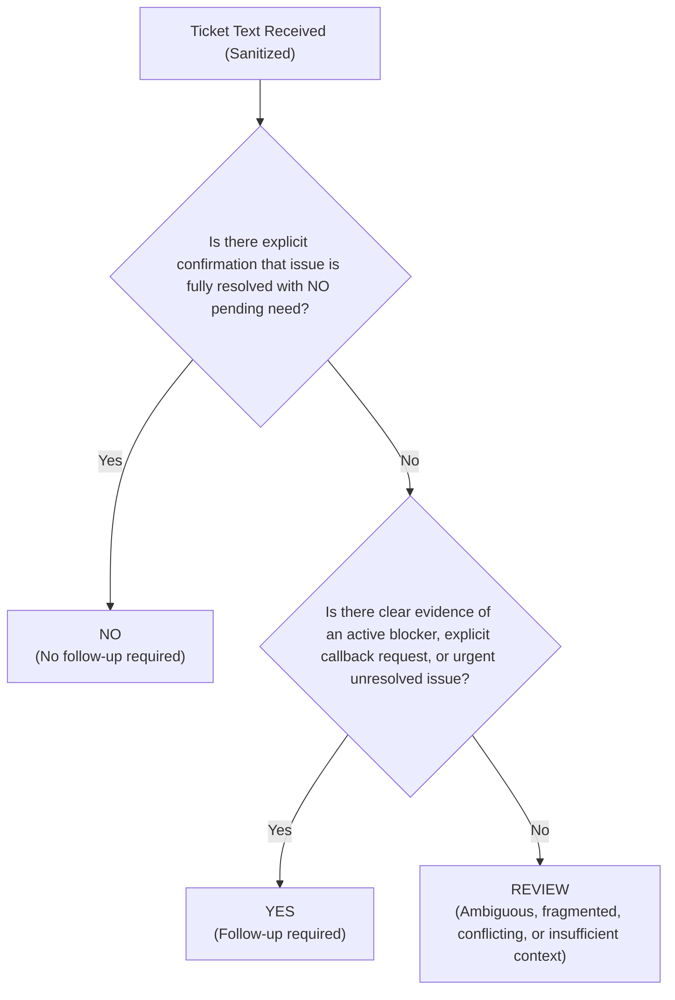

# Student Support Ticket Annotation and Labelling Guidelines

**Target Task:** DistilBERT 3-Class Follow-Up Classification (`YES`, `NO`, `REVIEW`)  
**Target Domain:** VIT-AP University Student Support & Advisory Operations  
**Specification Version:** `1.0.0`

---

## 1. Core Purpose and Mandatory Ground-Truth Rule

These guidelines govern how human annotators and domain experts assign ground-truth labels to student support ticket narratives for training the task-specific DistilBERT classifier.

> [!CRITICAL]
> **MANDATORY HUMAN-IN-THE-LOOP REQUIREMENT:**  
> Training ground-truth labels **MUST** be assigned by qualified, authorized human reviewers using available ticket context and institutional policy.  
> 
> **Under NO circumstances may labels automatically generated by rule-based heuristic engines, keyword matchers, or unverified model predictions be imported as training ground truth.** Importing automated predictions into training data creates self-reinforcing bias loops, masks model limitations, and violates institutional data governance.

---

## 2. Label Definitions and Decision Rubrics

Every training example must be assigned exactly one of three target labels:

### 2.1 Label: `YES` (Follow-Up Required)
Assign `YES` when there is **sufficient, unambiguous evidence** that human advisor intervention, contact, or outreach is required.

**Qualification Criteria:**
- **Explicit Contact Requests:** Student explicitly asks for a phone call, advisor meeting, or direct outreach (e.g., *"Please have an advisor call me"*, *"Requesting a callback regarding registration"*).
- **Active Financial / Technical Blockers:** Student reports an uncompleted critical process (e.g., fee debited twice, portal crashed during course registration, admit card missing 24 hours before examination).
- **Unanswered High-Stakes Inquiries:** Inquiries where student is actively blocked from university participation and automated FAQ answers cannot resolve the situation.

**Negative Examples (Do NOT label YES):**
- Ambiguous queries with only a topic name (e.g., *"hostel"* or *"fees"*): Label as `REVIEW`.
- Frustrated venting about past issues that were already closed: Label as `REVIEW` unless ongoing action is demanded.

---

### 2.2 Label: `NO` (No Follow-Up Required)
Assign `NO` when there is **sufficient, unambiguous evidence** that no further advisor follow-up or contact is needed.

**Qualification Criteria:**
- **Explicit Confirmation of Resolution in Text:** Student explicitly confirms the issue is resolved in their own narrative (e.g., *"Everything is sorted now, thank you"*, *"I received my refund receipt today"*, *"Problem was solved after clearing cache"*).
- **No Further Action Requested:** Explicit statement that no assistance is needed (e.g., *"No further help required"*, *"Issue resolved on my own"*).
- **Routine Self-Service Confirmations:** Student confirms receipt of documents or self-service completion.

**Negative Examples (Do NOT label NO):**
- **Closed Ticket Status Alone:** A ticket marked "Closed" in the CRM where the student text does NOT explicitly confirm satisfaction must **NOT** be labelled `NO`. It must be labelled `REVIEW`. Missing information is never inferred as resolution.
- Polite greetings without query (e.g., *"Thank you sir"*): If the preceding issue is not visible, label `REVIEW`.

---

### 2.3 Label: `REVIEW` (Ambiguous, Fragmented, Conflicting, or Insufficient Evidence)
Assign `REVIEW` whenever the text **lacks sufficient evidence** to reliably determine follow-up necessity.

**Qualification Criteria:**
- **Ambiguous or Keyword-Only Text:** Submissions containing only keywords or fragments (e.g., *"fees"*, *"hostel room allotment"*, *"status please"*).
- **Incomplete or Truncated Inquiries:** Inquiries truncated mid-sentence (e.g., *"I was trying to pay through the portal and then..."*).
- **Conflicting Signals:** Internal contradictions within the record (e.g., ticket closed by agent, but student writes *"problem still persisting"*).
- **Uncertainty / Gray Areas:** Any case where a human reviewer cannot defend a confident `YES` or `NO` without guessing student intent.

---

## 3. Handling Operational Edge Cases

### 3.1 Class Imbalance
- In university ticketing, routine open inquiries (`YES`) and vague queries (`REVIEW`) often outnumber explicitly resolved statements (`NO`).
- **Guideline:** Annotators must label strictly according to textual evidence without artificially altering labels to balance class counts.
- Imbalance is handled mathematically during training via **class weighting** in the cross-entropy loss function, not by biasing human labels.

### 3.2 Duplicate Tickets and Canned Queries
- Students frequently submit multiple tickets for the same problem within hours.
- **Guideline:** 
  1. Detect duplicate or near-duplicate texts from the same student.
  2. Assign identical tickets the same `group_id` (anonymized student/case hash).
  3. Ensure that all tickets sharing a `group_id` reside in the **same split** (e.g., all in `TRAIN` or all in `TEST`).
  4. Deduplicate exact string matches within the training set to prevent gradient over-indexing on boilerplate text.

### 3.3 Conflicting Annotations and Adjudication Protocol
- When two annotators disagree on a ticket (e.g., Annotator A assigns `YES`, Annotator B assigns `REVIEW`):
  1. Flag record with `adjudication_status = "FLAGGED_CONFLICT"`.
  2. Route to the **Senior Support Adjudicator** for binding resolution.
  3. Once resolved, update `adjudication_status = "APPROVED"` and set `label_provenance = "ADJUDICATED_EXPERT"`.
  4. If consensus cannot be achieved even after expert review, set `adjudication_status = "EXCLUDED"` to remove the example from the training pool.

---

## 4. Privacy, Consent, and Data Protection Standards

### 4.1 Strict Exclusion of PII
To comply with the Digital Personal Data Protection (DPDP) Act 2023, FERPA, and ethical ML principles:
1. **Never copy raw student names, phone numbers, application/registration numbers, or email addresses into the training text.**
2. All identifiers must be scrubbed using standardized tokens before entering the model input text:
   - Student Name $\rightarrow$ `[STUDENT_NAME]`
   - Phone Number $\rightarrow$ `[PHONE_NUMBER]`
   - Application / Registration Number $\rightarrow$ `[APPLICATION_NUMBER]`
   - Email Address $\rightarrow$ `[EMAIL]`
3. Raw identifiers and contact details remain in the secure operational database for CRM lookup; they must **never** be used as training features.

### 4.2 Data Access and Annotator Controls
- Annotators work only in air-gapped or role-based access environments.
- Annotators must never export, screenshot, or store student data on personal devices.

---

## 5. Examples to Strictly Exclude from Training

The following categories must have `adjudication_status = "EXCLUDED"` and be excluded from training datasets:

1. **Non-English Submissions:** Text in regional languages or transliterated vernacular (Hinglish/Telugu-English) pending multilingual model support.
2. **Spam / Test Submissions:** Internal staff tests (e.g., *"testing 123"*, *"asdfghjk"*).
3. **Severe Telephony / Speech-to-Text Garble:** Transcripts corrupted beyond human comprehension.
4. **Unredactable Sensitive PII:** Tickets containing bank PINs, passwords, or personal health records that cannot be safely redacted.
5. **System Log Dumps:** Automated webhook or stack trace dumps pasted into descriptions without student narrative.

---

## 6. Reference Examples for Annotators

| Example ID | Sanitized Text Input | Ground Truth Label | Provenance | Reviewer Rationale |
|---|---|---|---|---|
| `REF-01` | "Payment of Rs 25,000 was deducted twice from my account during hostel booking but portal shows unpaid. Please call me back urgently." | `YES` | `HUMAN_SINGLE_REVIEW` | Explicit callback request and severe financial blocker. |
| `REF-02` | "Admit card is not showing my photo and exam is tomorrow morning. Need urgent help." | `YES` | `HUMAN_CONSENSUS` | Imminent deadline blocker preventing examination attendance. |
| `REF-03` | "The fee receipt issue is resolved now, I was able to download the PDF from student portal. Thanks for your help." | `NO` | `HUMAN_SINGLE_REVIEW` | Explicit confirmation in text that problem is completely sorted. |
| `REF-04` | "Everything is working fine now after restarting my laptop, no further assistance needed." | `NO` | `HUMAN_SINGLE_REVIEW` | Explicit confirmation of resolution and confirmation that no help is needed. |
| `REF-05` | "fees" | `REVIEW` | `HUMAN_SINGLE_REVIEW` | Single keyword query with no context, intent, or actionable details. |
| `REF-06` | "hostel room 302" | `REVIEW` | `HUMAN_SINGLE_REVIEW` | Fragmented query; cannot determine if student wants allocation, maintenance, or refund. |
| `REF-07` | "Ticket marked resolved in portal but the error message is still coming up." | `REVIEW` | `ADJUDICATED_EXPERT` | Contradiction between portal status and student narrative. Requires human triage. |
| `REF-08` | "Please call me at [PHONE_NUMBER]." | `REVIEW` | `ADJUDICATED_EXPERT` | Callback requested but zero issue context provided; routing to REVIEW ensures advisor inspects records rather than auto-dialing blindly. |
| `REF-09` | "Thank you sir." | `REVIEW` | `HUMAN_SINGLE_REVIEW` | Courtesy message without confirmation of resolution or issue context. |
| `REF-10` | "Unable to submit assignment due to portal error, deadline is in 2 hours." | `YES` | `HUMAN_SINGLE_REVIEW` | Critical time-sensitive blocker requiring immediate advisor intervention. |
